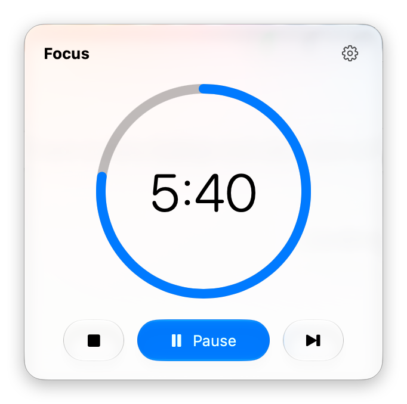

# PomoTide

A small Pomodoro timer that lives in the macOS menu bar. Features automatically turning on/off DoNotDisturb mode and playing/stopping playlists from Apple Music.

<p align="center"></p>

## Features

- Adjustable focus and break length, optional long break after a set number of sessions
- Remaining time in the menu bar, controls in a popover (start, pause, skip, stop)
- Ticking during focus from real clock recordings (wall clock or quartz clock), or Apple Music instead: pick a playlist, music pauses during breaks and continues afterwards
- Gong or singing bowl at the start and end of every break
- Optional break sound: ocean waves or white, pink or brown noise
- Do Not Disturb during breaks (on by default) and optionally during focus
- Native Swift and SwiftUI, no dependencies, light on resources

## Requirements

macOS 26 or later.

## Install

There are no prebuilt releases yet, so build it from source. You need the Xcode Command Line Tools (`xcode-select --install`) with Swift 6.2 or later.

```sh
git clone <repository-url> pomotide
cd pomotide
./build.sh --install
open ~/Applications/PomoTide.app
```

`./build.sh` alone builds `build/PomoTide.app` without installing it. To start PomoTide at login, add it under System Settings > General > Login Items & Extensions.

## Do Not Disturb setup

macOS has no public API for apps to switch Focus, but Shortcuts can. PomoTide ships two signed shortcuts, "PomoTide Focus On" and "PomoTide Focus Off", and runs them when a phase changes.

1. Open PomoTide from the menu bar and click **Set Up**.
2. Shortcuts opens twice; click **Add Shortcut** each time.

Settings shows "Shortcuts installed" once both are there. Without them the timer works normally, it just does not touch Do Not Disturb. To use your own Focus instead of Do Not Disturb, change the Focus in both shortcuts in the Shortcuts app.

## Development

| Path | Purpose |
|---|---|
| `Sources/PomoTide/` | App code |
| `Resources/Sounds/` | Bundled sounds |
| `Resources/Shortcuts/` | Signed Focus shortcuts |
| `tools/prepare_sounds.py` | Cuts and levels the sounds from the source recordings |
| `tools/make_shortcuts.py` | Generates and signs the shortcuts (needs a Mac signed in to iCloud) |

The generated sounds and shortcuts are committed, so a normal build needs neither tool.

## Sound credits

All bundled sounds are CC0 recordings, see [CREDITS.md](CREDITS.md).

## License

MIT, see [LICENSE](LICENSE).
